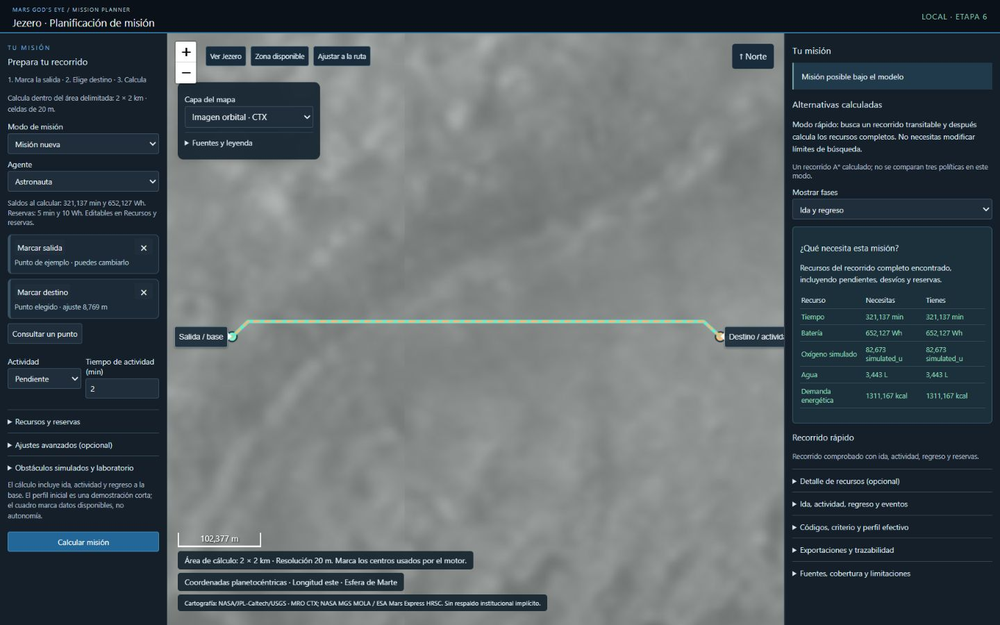

# ETAPA 06 — Cierre y continuidad del Mission Planner

**Estado general: INCOMPLETA respecto del alcance ampliado solicitado.**

Fecha de consolidación: **2026-11-06**, America/Bogota.

La aplicación local funciona, ejecuta el motor real y cuenta con pruebas y
verificación de navegador. El flujo rápido con A* y preparación de recursos está
comprobado. Continúan pendientes la planificación de todo el cráter Jezero, una
capa orbital en color verificada y curvas continuas geométricamente validadas.
No se declara completado ese alcance ni se inicia la etapa 7.

## 1. Checkout y preservación

- Checkout: `C:\Users\laura\OneDrive\Escritorio\MARS GOD EYE\NASA-Sandbox-etapa01`.
- Rama comprobada: `etapa01-base-confiable`.
- HEAD/commit base: `0d5a444f5444b4dfa574224c9f7d09652dad1df5`.
- Estado local comprobado al consolidar: `.gitignore` modificado; directorios
  `docs/continuidad/`, `prototypes/` y `data/mission_planner_ctx_2km/` sin seguimiento.
- Cambios de etapas anteriores, originales, datos Jezero y evidencias preservados.
- No se modificaron Gods Eye View ni el piloto Jezero o sus evidencias.
- No hubo commits, push, PR, clonación nueva, cambio de rama, clean o reset.

Se revisaron AGENTS.md y las instrucciones aplicables durante la implementación.
Las instrucciones del mundo Gazebo no se usaron para ampliar el alcance local.

La versión acumulativa anterior de este documento se conserva íntegra en
[ETAPA_06_CIERRE_PRE_CONSOLIDADO_2026-11-06.md](ETAPA_06_CIERRE_PRE_CONSOLIDADO_2026-11-06.md).
También se conservan los cierres previos `ETAPA_06_CIERRE_PRE_MAPA.md` y
`ETAPA_06_CIERRE_PRE_IMPACTO.md`. Los cierres 01–05 no se sobrescribieron.
Este documento describe el estado final observado, no las soluciones intermedias
que luego fueron sustituidas.

## 2. Cómo iniciar, abrir y detener

Comando exacto desde cualquier directorio en PowerShell:

```powershell
& 'C:\Users\laura\OneDrive\Escritorio\MARS GOD EYE\NASA-Sandbox-etapa01\.venv-stage04\Scripts\python.exe' 'C:\Users\laura\OneDrive\Escritorio\MARS GOD EYE\NASA-Sandbox-etapa01\prototypes\mission_planner\mission_ui.py'
```

Acceso: **[http://127.0.0.1:8766/](http://127.0.0.1:8766/)**.

Parada: **Ctrl+C en la consola donde se lanzó el comando**. Se cierra el socket.
Si existe una instancia anterior en el puerto, usarla o detenerla antes de iniciar
otra. Una instancia lanzada desde Codex puede detenerse solicitándolo a Codex.
`--port` permite otro puerto local; el servidor sigue ligado a `127.0.0.1`.
No se publica ni se expone a la red.

El arranque habitual utiliza los datos preparados locales. Leaflet está guardado
en el proyecto; las imágenes remotas requieren internet, el motor no.

## 3. Flujo de uso actual

1. Elegir astronauta o rover y acercar la **Zona disponible**.
2. Pulsar **Marcar salida** y hacer clic en el mapa; repetir con **Marcar destino**.
3. Definir el tiempo de actividad y pulsar **Calcular misión**.
4. Revisar la tabla **Necesitas / Tienes**, el estado y el recorrido.
5. Si falta presupuesto para el candidato encontrado, pulsar
   **Preparar recursos para este recorrido**. El ajuste es de recursos simulados;
   conserva reservas y vuelve a calcular/verificar.
6. Para una misión iniciada, elegir **Misión en curso**, marcar posición manual,
   introducir saldos y usar la evaluación continuar/regresar.

En misión nueva, base y posición actual coinciden; Python valida esa condición.
Los puntos pueden retirarse o cambiarse. La consulta muestra coordenadas y altura;
cuando un clic se ajusta al centro de celda se muestran punto elegido, centro
utilizado y distancia de ajuste. Un punto bloqueado no se mueve a otra celda libre.

Configuración a la izquierda, mapa central y resultados a la derecha en escritorio.
Tipografía compacta; metadatos, tasas, movilidad, exportaciones y diagnóstico son
plegables. Los paneles extensos pueden desplazarse internamente. La referencia
visual fue [NASA Open MCT](https://ammos.nasa.gov/openmct/); no se afirma afiliación
ni se usaron logotipos NASA.

El laboratorio anterior continúa en `/legacy/`, con retícula CTX de 4 m y escenario
sintético. Esa interfaz y sus fixtures no son la experiencia cartográfica principal.

## 4. Arquitectura y dependencias

Servidor HTTP local acotado de biblioteca estándar, HTML/CSS/JavaScript, Leaflet
1.9.4 local con su licencia BSD-2-Clause y mapa equirectangular marciano explícito.
Sin usuarios, cuentas, claves, base de datos, nube o backend general.

| Archivo o grupo bajo prototypes/mission_planner | Responsabilidad |
|---|---|
| `mission_ui.py` | Transporte localhost, catálogo, validación de construcción y archivos permitidos |
| `regional_ui.py` | Adaptador de selección geográfica y compatibilidad regional anterior |
| `expanded_ui.py` | Área CTX de 2 km, elección de método y condiciones de recursos |
| `fast_mission.py` | Candidato A* de ida/regreso y contabilidad con el motor existente |
| `mission_explanations.py` | Explicaciones de bloqueos, saldos, interrupciones y cotas optimistas |
| `jezero_map.py` | Coordenadas planetarias/locales y productos visuales del DEM |
| `prepare_ctx_2km.py` | Adquisición y reproyección acotada del CTX; no se ejecuta al planificar |
| `web/index.html`, `map-app.js`, `map.css` | Interfaz cartográfica actual |
| `web/vendor/*`, `web/legacy/*` | Biblioteca local con licencia y copia de interfaz previa |
| `test_stage06*.py`, `test_mission_explanations.py`, `test_expanded_ui.py`, `test_fast_mission.py` | Pruebas del puente, espacio, diagnósticos y flujo rápido |
| `test_stage06_frontend.cjs`, `test_stage06_map_frontend.cjs` | Regresiones unitarias JavaScript |

Python 3.11.9 en el entorno `.venv-stage04`; NumPy existente para CTX.
Rasterio 1.4.3 y sus dependencias se instalaron únicamente en ese entorno para
preparar la ventana nueva, según `requirements-maps-prep.txt`. El lector de JSON
preparado y el CORE no requieren importar Rasterio para calcular.

Cambios acotados al CORE, autorizados al solicitar otro algoritmo:

- `RiskAwareAStar.plan` acepta `max_expansions` opcional y una excepción de
  interrupción geométrica independiente. Sin argumento mantiene su comportamiento.
- `mission_decisions.effective_future_profile` centraliza la adaptación existente
  de tasas, escenarios, saldos y reservas para compartirla entre métodos.

No se cambiaron fórmulas de consumo, dominancia o políticas multirrecurso heredadas.
El CORE permanece importable y comprobable sin servidor, navegador o ROS.

## 5. Métodos de planificación y significado del resultado

### Modo rápido, predeterminado

Usa el A* geométrico existente para actual→destino y destino→base. Heurística:
distancia euclídea. Costo: distancia ponderada por factores geométricos del terreno.
Conserva huella, pendiente máxima, diagonales sin cortar esquinas y obstáculos.
Cada tramo está limitado a **5.000 expansiones**, no a etiquetas multirrecurso.

Después calcula todos los consumos del recorrido completo mediante
`ResourceMissionPlanner`, `Consumption` y `_breakdown`. No duplica las fórmulas
en JavaScript. Actividad completada no se vuelve a cobrar.

Si el candidato excede el presupuesto, se guarda separado en `candidate_plan`:
no se presenta como misión SUCCESS ni se exportan waypoints confirmados hasta
que los saldos sean suficientes. Este rechazo corresponde a ese candidato;
**no demuestra que todas las demás rutas sean inviables**. El modo rápido no
promete óptimo multirrecurso ni compara tres políticas.

### Modo detallado y misión en curso

La búsqueda Dijkstra multietiqueta anterior sigue en ajustes avanzados y en la
evaluación continuar/regresar. Compara restricciones de recursos durante la
búsqueda. Conserva el límite de 5.000 etiquetas por búsqueda y la semántica heredada.

La comparación detallada recomienda entre SUCCESS: menor tiempo, luego batería
y desempate balanced/minimum_time/terrain_caution. No compara directamente
costos obtenidos con pesos diferentes. No llama a una ruta «la más segura».
Continuar visita el destino aunque la actividad esté completada; regresar vuelve
directamente sin revisitarlo. Las decisiones CONTINUE, RETURN y REVIEW_* siguen
siendo las del motor existente.

### Interrupciones y errores

SUCCESS, INFEASIBLE, SEARCH_LIMIT_REACHED e INVALID_INPUT se conservan en detalles
y exportación. Una interrupción deja factibilidad desconocida. Falta de recursos,
obstáculos y entrada inválida tienen explicaciones distintas cuando hay evidencia;
no se inventa una causa única al agotarse la búsqueda detallada.

Errores esperados de construcción/validación se presentan como INVALID_INPUT,
con HTTP 400 cuando corresponde. Errores internos inesperados son HTTP 500 y no
se convierten en resultados de inviabilidad.

## 6. Recursos y ajuste corregido

Se distinguen capacidad original, saldo actual, consumo futuro, restante al
regresar, reserva absoluta y margen. No se rebaja la reserva a un porcentaje del
saldo ni se descuenta de nuevo el histórico. Rover muestra recursos humanos
No aplica; astronauta permite exclusiones experimentales con motivo explícito.
Masa y altura son opcionales e informativas, sin efecto en los consumos actuales.
No se solicita edad, sexo o género.

El botón de preparación utiliza el **consumo de un recorrido completo encontrado
más su reserva**, incluidos ascensos y desvíos. Aumenta saldo/capacidad simulados
solo cuando hace falta, conserva tasas y reservas y vuelve a verificar. Registra
valores anteriores, cambios, ID de cálculo y fundamento en
`configuration.resource_adjustments`, que se exporta.

El ajuste anterior basado solamente en cotas optimistas fue sustituido para el
flujo principal: si el método detallado solo ofrece esa cota, el botón primero
busca un candidato con A* en lugar de aplicar reiteradamente una cantidad que
puede quedarse corta. Los puntos, el terreno y las tasas deben mantenerse iguales
para que los consumos del candidato sigan siendo aplicables.

## 7. Datos, área de cálculo y cartografía

**Cobertura habilitada: 2 × 2 km, 100 × 100 celdas de 20 m**, límites E/N
`[-1000,1000]` respecto al origen Jezero 77.45° E / 18.45° N. Son 10.000 celdas;
no es la cobertura completa del cráter. El mapa visual permite explorar una zona
mayor; fuera del polígono no se promete cálculo.

Datos en `data/mission_planner_ctx_2km/`:

- `terrain.json`: elevaciones CTX preparadas.
- `source-window.npy`: muestras de la ventana fuente.
- `metadata.json`: fecha, fuente, CRS, ventana, método y SHA-256 de ambos archivos.

Se obtuvo únicamente una ventana del producto CTX público identificado en etapa 4,
columna 803, fila 751, ancho 110, alto 104. Reproyección GDAL por promedio a 20 m,
sin relleno de desconocidos ni alturas HiRISE. No se alteraron el parent 512 m,
el recorte de demostración anterior o los datos del piloto.

Preparación inicial, solo si faltan los archivos preparados:

```powershell
& .\.venv-stage04\Scripts\python.exe -m pip install -r prototypes/mission_planner/requirements-maps-prep.txt
& .\.venv-stage04\Scripts\python.exe prototypes/mission_planner/prepare_ctx_2km.py
```

El preparador rechaza sobrescribir una adquisición ya existente. El arranque normal
no descarga el DEM y verifica el checksum del JSON.

Capas disponibles:

| Capa | Fuente / producto | Límite |
|---|---|---|
| Imagen orbital gris | MRO CTX / USGS, mosaico controlado, NASA Trek | Aproximadamente 6 m/píxel, cobertura parcial de Jezero |
| Contexto sombreado | MGS MOLA + Mars Express HRSC, NASA Trek | Producto 200 m/píxel, origen variable |
| Sombreado local | Derivado del CTX local de 20 m | Iluminación calculada NW/315°, altura 45° |
| Elevación local | CTX absoluto con color añadido y leyenda en m | Solo el área de cálculo |

No se pintó de rojo una imagen gris para presentarla como color natural. Las
imágenes visuales no entran inadvertidamente en el conocimiento del planificador.
Los obstáculos que añade el usuario son **SIMULADOS**, ocupan una celda completa
de 20×20 m y producen un snapshot nuevo. Restaurar no modifica el CTX original.

Fuentes: [NASA Trek WMTS](https://trek.nasa.gov/tiles/apidoc/trekAPI.html?body=mars),
[explorador ESA de Jezero](https://www.esa.int/Science_Exploration/Space_Science/Mars_Express/An_interactive_map_to_explore_Jezero_crater),
metadatos USGS/CTX del importador y documentación oficial de Leaflet/Rasterio.
Catálogo, GetCapabilities, metadatos y muestras reales se conservaron en
`evidence/stage06_maps/`. Viking respondió a la prueba de tesela, pero no se ofreció
por metadatos de acceso/uso contradictorios; se empleó MOLA/HRSC de contexto.
Una candidata adicional de Jezero en `stage06_impact/` resultó gris y no se integró
como color natural. No se eludieron certificados ni restricciones de acceso.

## 8. Marcos, selección y rutas

- Esfera de Marte: R=3.396.190 m; latitud planetocéntrica y longitud este.
- WMTS equirectangular: origen (-180°,90°), teselas 256×256,
  matrices ancho `2^(z+1)` y alto `2^z`. No se usa Web Mercator terrestre.
- Marco local: `E=R*cos(lat0)*(lon-lon0)`, `N=R*(lat-lat0)`, en radianes,
  lat0=18.45°, lon0=77.45°. Inversa explícita.
- Afín regional actual: `[-1000,20,0,1000,0,-20]`.
  Filas crecen al sur; columnas al este. Centro NW=(-990,990) m.
- Marco interno del motor: X este/Y sur desde esquina NW. Centros de celda en
  índices +0,5. Selección semiabierta: norte/oeste incluidos, sur/este excluidos.
- Las rutas se dibujan con las mismas celdas/coordenadas que calcula Python.
  Ida y regreso coincidentes se superponen con estilos distintos, sin desplazarlos.

Hay giros y desvíos reales en ocho direcciones. El redondeo de extremos de línea
es presentación; **no se han implementado curvas continuas transitables**. No se
interpolan curvas que atraviesen terreno no comprobado.

## 9. Ejecución, resultados anteriores y exportaciones

Guardia cliente, tokens y lock no bloqueante evitan solicitudes duplicadas y
sobrescrituras por respuestas anteriores. La configuración sigue inspeccionable.
Cada edición marca resultados anteriores y retira rutas obsoletas. No hay
cancelación aparente. Los límites se mantienen acotados, sin incrementos automáticos.

`sessionStorage` conserva la configuración en la misma pestaña, ligada a la revisión
del DEM; una recarga requiere calcular un resultado nuevo. No recupera entradas
que una versión anterior nunca guardó.

Descargas comprobadas de configuración, resultado JSON estricto y rutas/waypoints.
Conservan versiones, método, estados, perfil original/efectivo, saldos/reservas,
escenario/factores, marcos/unidades, snapshot, procedencia y perturbaciones.
La envolvente rápida usa `ui_schema=6.1`; los contratos heredados mantienen 3.0/5.0.
Los candidatos que aún exceden presupuesto quedan diferenciados del plan admisible.
Las descargas corresponden al cálculo mostrado, no a entradas editadas después.

## 10. Conectividad y seguridad local

Solo las imágenes/teselas remotas requieren internet durante el uso. Motor, DEM
preparado, relieve/elevación local y exportaciones son locales. La adquisición
inicial de elevaciones sí requirió internet.

«Solo datos locales» desactiva solicitudes de teselas y explica qué capa no está
disponible. Fallos de red o cobertura muestran un mensaje; no se cambia en silencio
a terreno sintético. Se comprobó modo local con cero teselas remotas, PNG cargado
y cálculo real. No se desconectó físicamente la red del equipo para esa prueba.

No hay proxy abierto: las imágenes se solicitan directamente a NASA Trek. El puente
comprueba Host/Origin locales, limita solicitudes a 64 KiB y solo sirve archivos y
operaciones enumerados. No ofrece lectura arbitraria ni despliegue público.

## 11. Pruebas y evidencias reales

**Última suite completa registrada: 101/101 Python, 21.295 s, sin skips.**
Log: [stage06_fast/tests.log](../../prototypes/mission_planner/evidence/stage06_fast/tests.log).
Incluye las 71 regresiones iniciales y ampliaciones de puente, mapas, diagnósticos,
área de 2 km y modo rápido. Suite JavaScript regional aprobada y sintaxis comprobada.
No se afirma que esta consolidación documental haya vuelto a ejecutar la suite.

Desde la raíz del checkout:

```powershell
& .\.venv-stage04\Scripts\python.exe -m unittest discover -s prototypes/mission_planner -v
& 'C:\Users\laura\.cache\codex-runtimes\codex-primary-runtime\dependencies\node\bin\node.exe' prototypes/mission_planner/test_stage06_frontend.cjs
& 'C:\Users\laura\.cache\codex-runtimes\codex-primary-runtime\dependencies\node\bin\node.exe' prototypes/mission_planner/test_stage06_map_frontend.cjs
```

Las pruebas HTTP requieren permitir sockets locales; se ejecutaron fuera del
sandbox restringido con autorización. Las pruebas CORE sin UI y dependencias GIS
siguen incluidas. No se usaron skips para declarar integración completada.

Verificación real con navegador integrado CUA:

- Cartografía remota, zoom/desplazamiento, capas y selección geográfica.
- Misión astronauta/rover, recursos No aplica y actividad completada sin recobro.
- Comparación detallada, misión en curso y continuar/regresar.
- Insuficiencia, interrupción, inválido, punto fuera de cobertura y obstáculos.
- Restauración y resultado nuevo tras modificar actividad o destino.
- Exportaciones desde botones y configuración conservada al recargar.
- Flujo rápido: candidato de 1233,137 m con presupuesto insuficiente; botón de
  preparación; SUCCESS posterior, 316,137 min y 642,127 Wh consumidos, más 10 Wh
  de reserva. La tabla Necesitas/Tienes coincidió tras el ajuste.

El escritorio se comprobó a 1280×720 y 1440×900/1000 según la iteración. El ancho
reducido de 390×844 se comprobó en la interfaz cartográfica anterior; la última
iteración del flujo rápido se comprobó en escritorio. Las pruebas de doble DOM
no sustituyen esa verificación real ni prueban por sí solas el diseño.

| Evidencia bajo prototypes/mission_planner/evidence | Contenido |
|---|---|
| `stage06/` | Primera interfaz, puente y bloqueo visual histórico |
| `stage06_maps/` | Investigación de servicios, 89 pruebas, capturas, descargas y marcos |
| `stage06_diagnostics/` | 93 pruebas y casos de tres obstáculos / déficit explicado |
| `stage06_impact/` | Consola compacta, muestra de capa candidata y capacidades |
| `stage06_simple/` | 97 pruebas, ventana 2 km, recorrido con desvío, condiciones y DOM |
| `stage06_fast/` | 101 pruebas, ajuste exacto de candidato, persistencia, DOM y capturas |



### Rendimiento observado

Mediciones de llamadas completas, no promesas de tiempo real:

| Caso | Método | Resultado / observación |
|---|---|---|
| Recorrido ~1306 m con tres obstáculos | A* rápido | Antes INFEASIBLE por presupuesto; después SUCCESS sobre el mismo path |
| Mismo ensayo, antes/después de ajuste | A* rápido | Aproximadamente 0,555 / 0,472 s en la ejecución observada |
| Casos finitos previos del área 2 km | Detallado | Entre 1,31 y 1,70 s; log JSON en stage06_simple |

Las mediciones de asignaciones Python de iteraciones previas se conservan en sus
registros originales; no se presentan como memoria total del proceso ni como
medición del modo rápido final.

## 12. Aceptación del estado actual

| Requisito | Estado / evidencia |
|---|---|
| Aplicación local con motor real | Cumple; servidor localhost y navegador |
| Selección de agente, salida y destino | Cumple; sin filas/columnas en flujo principal |
| Actividad, recursos, reservas y escenario | Cumple; perfiles diferenciados |
| Ida, actividad y regreso | Cumple; consumo del motor y fases inspeccionables |
| Comparación de políticas y continuar/regresar | Cumple en método detallado; separado del modo rápido |
| Preparación de recursos que se vuelve a verificar | Cumple para candidato A*; prueba automatizada y navegador |
| Estados y resultados anteriores | Cumple; interrupción distinta de inviabilidad |
| Obstáculos simulados y restauración | Cumple; snapshots separados y áreas reales de celda |
| Exportaciones y trazabilidad | Cumple; descargas reales y contratos |
| CORE independiente y regresiones | Cumple; 101 pruebas sin skips |
| Cartografía real y área mayor que 28 m | Cumple; área actual de 2 km con CTX identificado |
| Planificación de todo el cráter | **Pendiente** |
| Capa orbital en color verificada | **Pendiente** |
| Curvas continuas validadas | **Pendiente**; solo giros de retícula comprobados |
| Último flujo rápido en ancho reducido | **Pendiente de repetir**; iteración cartográfica previa sí comprobada |

## 13. Limitaciones y trabajo pendiente

1. La cobertura de cálculo es de 2 km, no todo Jezero. Ampliarla requiere DEM
   identificado, resolución apropiada y pruebas finitas de rendimiento y marcos.
   No basta con agrandar el rectángulo de pantalla.
2. Falta integrar una capa orbital en color con servicio, registro, atribución y
   condiciones verificadas. Un filtro rojo no sustituye color científico.
3. Faltan curvas continuas validadas contra geometría/huella y contabilidad. Las
   rutas actuales siguen segmentos admisibles entre centros.
4. El modo rápido encuentra un candidato geométrico, no un óptimo multirrecurso.
   Puede existir una alternativa de menor consumo que no evalúe este modo.
5. Ajustar saldos es una simulación, no provisión real de equipo. Las tasas no
   están calibradas para EVA; no se certifica seguridad ni autonomía física.
6. CTX de 20 m no resuelve rocas, senderos o peligros locales. Capas visuales no
   son observaciones del planificador; no se usa altura HiRISE reservada.
7. Repetir el flujo rápido final en ancho reducido antes de cerrar la ampliación.

La licencia/autoría de los originales conserva el pendiente heredado antes de
redistribución. El uso de esta aplicación es local y no se ha publicado.

## 14. Continuidad para etapa 7

No iniciar ROS 2 mientras la etapa 6 ampliada siga INCOMPLETA, salvo una nueva
instrucción explícita que cambie ese alcance. Primero resolver o acordar la salida
de los pendientes anteriores y registrar evidencia real de aceptación.

Cuando se autorice etapa 7, acordar comunicación ROS 2 o preparación verificable,
conservando contratos, marcos, snapshots, reservas y separación del CORE. No
confundir posición manual con telemetría ni rutas simuladas con movimiento medido.

**No se implementaron ROS 2, Nav2, Gazebo, hardware ni integración definitiva
con Gods Eye View. No hubo commits, push o PR.**
