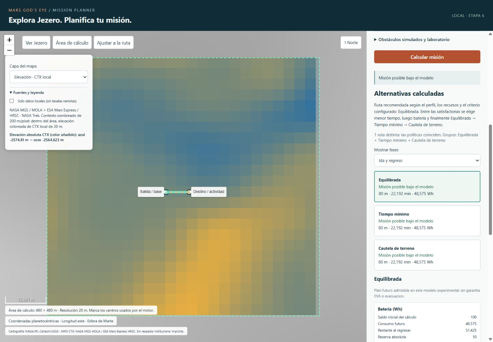

# ETAPA 06 — Mapa real de Jezero y planificación visual

**Estado de la ampliación solicitada el 2026-11-06: INCOMPLETA.**

La etapa anterior estaba completada. Se conserva íntegra en ETAPA_06_CIERRE_PRE_IMPACTO.md. Faltan planificación de todo el cráter y una capa orbital de color verificada. Fecha: 2026-11-05, America/Bogota.

Aplicación local comprobada en el navegador integrado: cartografía real navegable,
selección de salida/destino, cálculo con el motor Python, comparación, recursos,
misión en curso, exportaciones y ancho reducido. No se inició etapa 7.

## Trazabilidad y preservación

Checkout: `C:\Users\laura\OneDrive\Escritorio\MARS GOD EYE\NASA-Sandbox-etapa01`.
Rama: `etapa01-base-confiable`; HEAD/base:
`0d5a444f5444b4dfa574224c9f7d09652dad1df5`. Comprobados antes y después.

Estado heredado: `.gitignore` modificado, `docs/continuidad/` y `prototypes/`
sin seguimiento. Se preservaron datos, originales, trabajo local y evidencias.
Antes de actualizar este documento se guardó una copia íntegra en
[ETAPA_06_CIERRE_PRE_MAPA.md](ETAPA_06_CIERRE_PRE_MAPA.md).
El estado INCOMPLETA de esa primera interfaz es histórico; no se reescribió su evidencia.

Se revisaron AGENTS.md, cierres 01–06, README, contratos, adaptador, puente,
interfaz y pruebas. Se mantienen las instrucciones de separación del piloto.
No se modificaron Gods Eye View, el piloto Jezero, sus datos ni evidencias.
Los hashes de siete fuentes heredadas CORE/adaptador/demos coinciden con el
registro previo `evidence/stage06/preserved-core-sha256.json`.

Referencia inicial reejecutada: **81/81 Python, 4.603 s, sin skips**. Las pruebas
JavaScript de la interfaz anterior también siguen pasando. No hubo commits,
push, PR, clonación, cambio de rama, clean, reset u operaciones destructivas.

## Diferencias respecto a la retícula anterior

El mapa ocupa la mayor parte de la pantalla; permite zoom/desplazamiento,
selector de capas, consulta geográfica, ajuste a cobertura/ruta y escala marciana.
La retícula deja de ser la experiencia principal. Sigue disponible como
laboratorio independiente en `/legacy/`, con CTX 4 m y escenario sintético.

El flujo principal es misión nueva: salida = base = posición actual, destino,
actividad, recursos y «Calcular misión». La igualdad se valida en Python.
«Misión en curso» habilita posición manual, saldos y continuar/regresar.
Los campos técnicos de movilidad, tasas, recursos y trazabilidad son plegables.
No se piden filas/columnas para el flujo principal.

## Inicio, acceso y parada

Desde cualquier directorio en PowerShell:

```powershell
& 'C:\Users\laura\OneDrive\Escritorio\MARS GOD EYE\NASA-Sandbox-etapa01\.venv-stage04\Scripts\python.exe' 'C:\Users\laura\OneDrive\Escritorio\MARS GOD EYE\NASA-Sandbox-etapa01\prototypes\mission_planner\mission_ui.py'
```

Abrir [http://127.0.0.1:8766/](http://127.0.0.1:8766/).
Detener con **Ctrl+C en la consola donde se inició**. Solo escucha en 127.0.0.1.
La instancia final iniciada por Codex queda disponible en ese puerto; puede
pedirse a Codex que la detenga. Si ya está abierta, no iniciar una segunda.
El argumento `--port` permite otro puerto local; no permite exponer otra interfaz.

El arranque es independiente del directorio actual. NumPy ya existe en
`.venv-stage04`; no se agregaron dependencias Python ni se necesitan cuentas/claves.
Leaflet 1.9.4 estable está guardado localmente con licencia BSD-2-Clause.

## Arquitectura y archivos

El CORE, API 3.0 y decisiones 5.0 permanecen sin cambios. `mission_ui.py`
conserva el transporte acotado y usa `RegionalBridge` al arrancar como aplicación.
`regional_ui.py` adapta la región y la selección geográfica al mismo motor.
`jezero_map.py` contiene únicamente transformaciones, agregación CTX y productos
visuales. JavaScript no vuelve a calcular rutas, consumos o decisiones.

| Archivo bajo prototypes/mission_planner | Propósito |
|---|---|
| `mission_ui.py` | Endpoints de selección, archivos web y excepción unificada al arrancar como script |
| `regional_ui.py` | Nuevo adaptador regional, misión nueva/en curso y waypoints planetarios |
| `jezero_map.py` | Región 20 m, conversión explícita, PNG de elevación y sombreado |
| `web/index.html`, `map.css`, `map-app.js` | Nueva experiencia cartográfica en español |
| `web/vendor/*` | Leaflet 1.9.4, CSS y licencia, sin CDN durante uso |
| `web/legacy/*` | Copia de la interfaz anterior; `app.js`/`style.css` originales se conservan |
| `test_stage06_maps.py` | Ocho nuevas pruebas espaciales, regionales, HTTP y del arranque real |
| `test_stage06_map_frontend.cjs` | Regresiones de presentación/concurrencia de la nueva interfaz |
| `README.md` | Guía actualizada |
| `evidence/stage06_maps/*` | Investigación, mediciones, capturas y descargas reales |

No proxy cartográfico: el navegador solicita imágenes directamente a NASA Trek.
El servidor solo sirve archivos enumerados, PNG locales, catálogo e inspección/
cálculo/selección acotados. Comprueba Host/Origin locales, limita entradas a
64 KiB y no ofrece URLs arbitrarias, usuarios, almacenamiento general o nube.
La política de contenido permite imágenes de `trek.nasa.gov` y recursos locales.
No se modificaron heurísticas, dominancia, función objetivo o fórmulas del motor.

## Fuentes y servicios comprobados

Se investigaron las referencias del encargo, no solo sus páginas. Catálogo,
metadatos, GetCapabilities y muestras reales están conservados en evidencia.
Se usó [documentación oficial NASA Trek](https://trek.nasa.gov/tiles/apidoc/trekAPI.html?body=mars)
y [Leaflet 1.9.4](https://leafletjs.com/reference-1.9.4.html).

| Capa | Servicio / datos | Resolución y cobertura |
|---|---|---|
| Imagen orbital CTX | NASA Trek WMTS `JEZ_ctx_B_soc_008_orthoMosaic_6m_Eqc_latTs0_lon0` | MRO/CTX, mosaico USGS controlado, ~6 m/píxel; 77.1604655–77.6991776 E, 18.2110274–18.7211945 N |
| Contexto y relieve regional amplio | WMTS `Mars_MOLA_blend200ppx_HRSC_Shade_clon0dd_200mpp_lzw` | Sombreado de DEM MOLA/HRSC, producto 200 m/píxel, origen variable; cobertura global |
| Relieve local | Derivado del CTX local agregado | 20 m; iluminación calculada NW/315°, altura de luz 45°, exclusivamente en 480×480 m |
| Elevación local | Mismo CTX local | Alturas absolutas en m, leyenda azul→ocre con color añadido; 480×480 m |

CTX se muestra explícitamente sobre relieve de contexto MOLA/HRSC; fuera del
mosaico no se inventa imagen orbital. Las capas locales se amplían con píxeles
visibles; el sobrezoom de imagen remota no implica más detalle nativo.
No se usa ninguna imagen como entrada de transitabilidad ni altura HiRISE.

WMTS: `https://trek.nasa.gov/tiles/Mars/EQ/{producto}/1.0.0/default/default028mm/{z}/{fila}/{columna}.{png|jpg}`.
Se verificaron teselas sobre Jezero: CTX HTTP 200/19.737 bytes; relieve HTTP
200/37.703 bytes; checksum/headers en `service-verification.json`.
El navegador cargó ambos productos reales (24 teselas cargadas y cero fallidas
al comprobar la vista general final).

Viking se investigó y se probó una tesela (HTTP 200/60.074 bytes), pero no se
incluyó: el FGDC publicado devuelve marcadores `TBD` y `Access_Constraints: PRIVATE`,
inconsistentes con su catálogo público. No se asumieron condiciones de reutilización
claras para ese servicio. Se usa el relieve real MOLA/HRSC como contexto.

La referencia ESA explica su explorador/HRSC/CTX; su servidor FU Berlin no pudo
verificarse mediante Python por certificado no confiable. No se desactivó TLS.
La referencia USGS antigua respondió 403 en la consulta web. Las fuentes del
importador CTX y el servicio documentado de NASA permitieron verificar la alternativa.
No se eludieron restricciones de acceso.

Atribución visible: NASA/JPL-Caltech/USGS; MRO CTX, NASA MGS MOLA y ESA Mars Express
HRSC. Los metadatos de CTX no declaran una restricción adicional en sus campos
Use_Constraints/Access_Constraints; el uso aquí es local de servicios documentados
para clientes WMTS, sin redistribuir un mosaico ni afirmar respaldo institucional.
No se emplean logotipos. Los metadatos remotos son incompletos y no se presentan
como licencia universal para todos sus materiales. Se conserva la licencia Leaflet.

## Cobertura de cálculo y datos

Se fijó **antes de evaluar** un área **480×480 m**, E/N `[-240,240]` respecto
al origen Jezero (77.45 E, 18.45 N), **24×24 celdas a 20 m: 576 nodos**.
`acceptance-plan.json` registra área, resolución, límite y seis misiones finitas.

Se reutilizó únicamente el prior CTX existente, sin descargar un DEM nuevo ni
un mosaico global. Parent 128×128 a 4 m/512 m; recorte `[4:124,4:124]` (120×120).
Agregación: promedio de bloques no solapados de 5×5 muestras de 4 m → una celda
20 m; cualquier desconocido produce celda desconocida, sin rellenar.
Esto promedia la interpolación bilineal heredada: suaviza extremos y pierde
detalle, no recupera alturas nativas independientes ni inventa detalle de 4 m.

El NPZ original conserva SHA-256
`18d20b39a680d93addc3c3151bb3f19a5f41fc8f9a170396d4094694bbd76d6b`.
El adaptador existente verifica integridad y solo decodifica `prior`; las alturas
HiRISE y la máscara conjunta siguen excluidas. `regional-provenance.json`
conserva fuente, ventana, referencia vertical, método, revisión y hash derivado.
No se aplicó `origin_z_m` derivado de la referencia HiRISE.

La región es bastante mayor que los 28 m de demostración, pero **no permite
planificar todo Jezero**. La selección fuera del polígono se rechaza con explicación.
Dentro se permiten puntos arbitrarios: el motor puede devolver éxito, inviabilidad
o interrupción según perfil, saldo y búsqueda; no se promete resolver toda pareja.
Las pruebas pequeñas a 4 m y sintéticas a 1 m permanecen intactas.

## Marcos, matrices y alineación

- Coordenadas visibles: latitud planetocéntrica y longitud positiva este; esfera
  de Marte R=3.396.190 m. No Web Mercator terrestre ni WGS84.
- WMTS equirectangular: origen NW `(-180,90)` grados, teselas 256×256,
  matriz ancho `2^(z+1)`, alto `2^z`; CTX niveles 0–13, relieve 0–8.
  La etiqueta XML `WGS84BoundingBox` es una estructura del servicio, no razón para
  sustituir el datum de Marte por el de la Tierra.
- Leaflet usa una CRS explícita LonLat: transformación `(lon/180+1, .5-lat/180)`
  con escala `256*2^z`. La escala métrica usa distancia sobre la esfera marciana.
- Marco local conserva equirectangular del parent: `E=R*cos(lat0)*(lon-lon0)`
  y `N=R*(lat-lat0)`, ángulos en radianes; inversa explícita, lat0=18.45,
  lon0=77.45. No usa latitud planetográfica elipsoidal.
- Región: afín `[-240,20,0,240,0,-20]`. Filas hacia sur, columnas hacia este.
  NW centro=(-230,230) m y SE=(230,-230) m. Internamente X este/Y sur desde NW;
  E=-240+X, N=240-Y. Centros con desplazamiento de medio píxel.
- Límite semiabierto: norte/oeste incluidos, sur/este excluidos para selección.
- Python resuelve clic→E/N→celda, valida transitabilidad sin reubicar a otra libre
  y devuelve punto elegido, centro utilizado y distancia del ajuste. Ambos se
  dibujan, unidos cuando difieren; los números se conservan en configuración.
- Los waypoints planetarios exportados provienen de la transformación Python.
  La ruta Leaflet usa las mismas celdas y coordenadas del catálogo Python.

Pruebas independientes: controles de borde/centro derivados del afín parent,
control de origen y arco de 1° de la esfera declarada, agregación contra muestras
CTX originales, orientación, rechazo de límites y coincidencia de waypoints.
Además se comprobó selección y superposición real en el navegador.

## Decisiones, recursos, revisiones y exportación

«Ruta recomendada según el perfil, los recursos y el criterio configurado»:
menor tiempo entre SUCCESS, luego batería, después balanced/minimum_time/
terrain_caution. No compara costos de pesos distintos, no certifica seguridad
ni óptimo global. Coincidencias se muestran explícitamente; no se inventan rutas.

Ida turquesa, actividad en destino, regreso naranja discontinuo, sin separación
geográfica ficticia cuando coinciden. Selector de fase y alternativa inspeccionable.
Fases/eventos muestran consumos del motor. Las etiquetas comprensibles conservan
SUCCESS/INFEASIBLE/SEARCH_LIMIT_REACHED/INVALID_INPUT en detalles y exportación.
Se conservan las cinco decisiones CONTINUE/RETURN/REVIEW_* y no se garantiza regreso.

Capacidad original, saldo inicial, consumo futuro, restante al regresar, reserva
absoluta y margen son distintos. Sin nuevo descuento de histórico ni reservas
porcentuales. Rover: humanos No aplica. Astronauta: recursos modelados o exclusión
experimental con motivo obligatorio. Actividad completada no se vuelve a cobrar;
continuar sigue visitando el destino. Masa/altura opcionales e informativas, sin
edad/sexo/género ni fórmula fisiológica nueva.

Ediciones incrementan revisión, marcan resultados anteriores y retiran rutas
obsoletas. Una respuesta posterior a una edición queda anterior. Guardia cliente,
tokens de solicitud/selección y lock no bloqueante del servidor previenen duplicados
y sobrescritura. Configuración sigue inspeccionable al calcular. Sin falsa cancelación.
Errores de construcción/contrato: INVALID_INPUT/HTTP 400; errores inesperados: 500
sin disfrazarlos de inviabilidad. La validación autoritativa sigue en Python.

Obstáculos son perturbaciones SIMULADAS sobre una copia y nuevo snapshot, con
revisión explícita; restaurar recupera el terreno original. No observaciones,
sensores o telemetría. Nuevas capas visuales no modifican el conocimiento del motor.

Descargas JSON estrictas desde navegador: configuración, resultado completo y
rutas/waypoints. Conservan versiones 6.0/3.0/5.0 según envolvente/contrato, perfiles
original y efectivo, saldos/reservas, escenario/factores, estados, marcos/unidades,
procedencia y perturbaciones. Waypoints incluyen E/N, latitud/longitud, altura,
celda, política y modo. Se descargan las entradas del cálculo mostrado, aunque se
edite después. Los tres archivos descargados realmente están en evidencia.

## Internet, caché y errores cartográficos

Imágenes/teselas de contexto requieren internet y se obtienen directamente de
NASA Trek. Leaflet, motor, DEM, relieve/elevación local, cálculo y exportaciones
funcionan sin teselas remotas. «Solo datos locales» desactiva sus solicitudes;
la imagen orbital declara entonces no estar disponible, sin sustitución silenciosa.
Relieve/elevación locales siguen visibles solo dentro de la región.

Un fallo de tesela muestra un mensaje de red/cobertura y ofrece las capas locales;
no deja un mapa vacío sin explicación ni cambia a terreno sintético. Se comprobó
fuera de cobertura real y modo local: cero teselas remotas, PNG local cargado y
misión SUCCESS. No se desconectó físicamente la red del equipo; este ensayo
verifica la indisponibilidad de la capa remota desde el control de la aplicación.

No existe caché global/proxy abierto. Se conservan únicamente muestras técnicas,
metadatos, capturas y fuentes locales necesarias. `artifact-manifest.json` registra
fecha UTC, tamaños/checksums; las URLs/headers de las consultas están en los registros.
El DEM parent retiene su fecha de adquisición y procedencia originales.

## Evaluación finita y rendimiento

Límite fijo heredado **5.000 etiquetas por búsqueda**; interrupción explícita con 1.
No se elevó para resolver la región ni se alteró el algoritmo. Las seis misiones
fijadas antes de la primera evaluación usan base (12,10), destino (12,12), actividad
2 min; posición intermedia (12,11) en el caso en curso. Cambiado: actividad 3 min;
insuficiente: batería restante 9 Wh con reserva 10 Wh. Perfil simulado heredado.

Una medición por caso con perf_counter y tracemalloc: llamada completa,
serialización incluida, carga CTX excluida. Pico de asignaciones Python, no toda
la memoria nativa ni RSS. No es un compromiso de tiempo real.

| Caso | Estados | Segundos | Pico Python bytes |
|---|---|---:|---:|
| Astronauta | SUCCESS / SUCCESS / SUCCESS | 1.012786 | 1793660 |
| Rover | SUCCESS / SUCCESS / SUCCESS | 0.978299 | 1521056 |
| Saldo insuficiente | INFEASIBLE / INFEASIBLE | 0.411039 | 870356 |
| Límite 1 | SEARCH_LIMIT_REACHED / SUCCESS | 0.411286 | 916519 |
| Actividad modificada | SUCCESS / SUCCESS / SUCCESS | 1.004292 | 1594741 |
| Posición intermedia | SUCCESS / SUCCESS | 0.495455 | 1024129 |

Astronauta desde base: **80 m, 22.191625977 min, 48.574877930 Wh** aproximadamente;
ver JSON para precisión completa. Etiquetas por política: 164/139/177;
rover 154/133/159. Una sola ruta distinta en este fixture. En navegador se marcó
además otro destino desde ancho 390 px: **96.569 m, 26.753 min, 58.117 Wh**.
Rutas nuevas fueron calculadas por Python; no son archivos reproducidos.

## Pruebas y verificación visual real

Comandos desde el checkout:

```powershell
& .\.venv-stage04\Scripts\python.exe -m unittest discover -s prototypes/mission_planner -v
& 'C:\Users\laura\.cache\codex-runtimes\codex-primary-runtime\dependencies\node\bin\node.exe' prototypes/mission_planner/test_stage06_frontend.cjs
& 'C:\Users\laura\.cache\codex-runtimes\codex-primary-runtime\dependencies\node\bin\node.exe' prototypes/mission_planner/test_stage06_map_frontend.cjs
```

**89/89 Python OK, 10.498 s, sin skips**: 81 anteriores y ocho nuevas. Ambas suites
JavaScript aprobadas; sintaxis válida; git diff --check limpio. Pruebas HTTP locales
se ejecutaron fuera del sandbox de sockets con autorización. CORE sigue comprobado
sin servidor/navegador/dependencias geoespaciales, incluidos subprocesos -S.

El navegador integrado funcionó en esta continuación. Se utilizó CUA con interacciones
reales, no un navegador sustituido por mocks. Escritorio 1440×1000 y ancho 390×844,
sin desbordamiento horizontal. Navegación, capas, selección, ajuste al centro, cálculo,
alternativa, fases, misión intermedia/completada, insuficiencia, interrupción, inválido,
rover, obstáculos/restauración y tres descargas fueron ejecutados.

Se detectó y corrigió un error real: al ejecutar `mission_ui.py` como script,
RegionalBridge podía importar una segunda copia y duplicar UIInputError. El arranque
ahora conserva identidad del módulo. Una nueva prueba inicia el script real en un
subproceso y exige HTTP 400 para actividad negativa. El caso se reprobó con éxito
en el navegador; el 500 inicial no se presenta como validación aprobada.

Evidencia en `prototypes/mission_planner/evidence/stage06_maps/`:

- `acceptance-plan.json`, `regional-evaluation.json`, `regional-performance.csv`:
  plan finito previo, resultados íntegros y mediciones.
- `regional-provenance.json`, `regional-catalog.json`: datos y marcos.
- `tests.log`, `frontend-unit.log`: resultados automatizados reales.
- `trek-config.json`, `trek-layers.json`, XML/HTML de productos,
  `service-verification.json`: servicios, matrices, metadatos, muestras y hashes.
- `browser-configuration.json`, `browser-result.json`, `browser-waypoints.json`:
  descargas desde botones. Resultado CONTINUE con actividad completada; sin science
  en eventos; cuatro waypoints de continuación y dos de regreso en ese caso.
- `browser-final-dom.txt`, `browser-console.json`: estado DOM y consola (sin errores).
- Capturas: `overview-final.jpg`, `overview-relief.jpg`, `selection.jpg`,
  `representative.jpg`, `route-elevation.jpg`, `continue-return.jpg`, `rover.jpg`,
  `insufficient.jpg`, `interrupted.jpg`, `invalid.jpg`, `outside-coverage.jpg`,
  `obstacle.jpg`, `context-coverage.jpg`, `offline-orbital.jpg`, `offline-local.jpg`,
  `narrow-final.jpg`, `narrow-results.jpg`. Algunas son pasos intermedios; la
  representativa y las capturas finales corresponden a flujos ejecutados.



## Tabla de aceptación

| # | Criterio | Evidencia / resultado |
|---|---|---|
| 1 | Jezero real reconocible | CTX + MOLA/HRSC cargados en navegador; vistas generales |
| 2 | Zoom/desplazamiento | Botones, ajuste y arrastre real; escala cambia |
| 3 | Imagen/relieve | Ambos servicios y PNG CTX local comprobados |
| 4 | Elevación con leyenda/unidades | PNG local, color identificado y valores CTX |
| 5 | Fuentes/cobertura visibles | Panel de capas y polígono 480 m |
| 6 | Salida/destino por clic | Selecciones reales, también ancho 390 px |
| 7 | Transformaciones y controles | Ocho tests nuevos + regresiones afín de etapa 4 |
| 8 | Ruta alineada | Centros Python, ajuste clic/centro mostrado, SVG Leaflet en coordenadas reales |
| 9 | Área útil mayor de 28 m | 480 m a 20 m; misiones regionales nuevas |
| 10 | Fuera de cobertura | Rechazo real con explicación y sin reubicación |
| 11 | Astronauta/rover reales | Éxitos en pruebas y navegador; humanos No aplica en rover |
| 12 | Modificación produce cálculo nuevo | Actividad 2→3 y destino móvil nuevo |
| 13 | Recomendación/coincidencias | Regla heredada, una ruta distinta explicitada |
| 14 | Ida/actividad/regreso | Estilos y selector, desglose/eventos, completada sin recobro |
| 15 | Recursos/reservas | Cuentas del motor y descargas; no doble descuento |
| 16 | Interrupción distinta | Límite 1 frente a saldo 9; capturas diferentes |
| 17 | Capa ausente/error | Cobertura real y modo local explícitos, manejador de tileerror; sin datos inventados |
| 18 | Exportación y coordenadas | Tres descargas verificadas, waypoints/región/latlon |
| 19 | Resultados anteriores | Rótulo real tras ediciones y pruebas de carreras/duplicados |
| 20 | Escritorio/ancho reducido | 1440×1000 y 390×844 con cálculo y capturas |
| 21 | Regresiones | 89/89 sin skips; suites JS anterior y nueva |
| 22 | CORE independiente | Hashes intactos; subprocesos sin servidor/UI/cartografía |

## Limitaciones y etapa 7

Los 480 m son cobertura de datos habilitada, no una garantía de factibilidad para
toda pareja. El motor multirrecurso puede interrumpirse con 5.000 etiquetas. CTX
20 m y el promedio suavizado no identifican obstáculos locales, senderos ni
seguridad operacional; las imágenes tampoco los convierten en conocimiento de ruta.
Metadatos de servicios remotos incompletos, disponibilidad y registro orbital
limitados; sin certificación de alineación física subpíxel ni garantías EVA.
Las tasas son simuladas y no hay fisiología, telemetría, sensores o movimiento medido.
La autoría/licencia de originales conserva su pendiente antes de distribución.

La etapa 7 queda pendiente de autorización: comunicación ROS 2 o preparación
verificable para ella, conservando contratos, marcos y separación del CORE. No se
implementaron ROS, Nav2, Gazebo, hardware, backend general ni integración definitiva
con Gods Eye View. **La implementación de esta etapa se detiene aquí.**


## Ajuste de usabilidad posterior: diagnóstico de misiones no admisibles

Ante la dificultad reportada al añadir tres obstáculos con astronauta, se añadió
`mission_explanations.py` y presentación contextual en la interfaz regional.
No se conocieron los puntos exactos del usuario; no se atribuye una causa única
a su solicitud. Se reprodujo por separado una misión de 80 m con tres obstáculos
que pasa sin ellos y resulta INFEASIBLE con ellos.

La interfaz ahora diferencia punto sobre obstáculo, saldo bajo reserva,
interrupción y búsqueda agotada. Cuando puede demostrarse un déficit incluso
para distancia directa sin penalizaciones, calcula un mínimo optimista usando
las funciones de consumo del motor y el perfil efectivo ya producido por la
fachada. No duplica fórmulas, no dibuja esa distancia como ruta, no cambia estados,
no aumenta recursos y no identifica falsamente una causa única en los demás casos.
El usuario dispone de botones para revisar recursos, localizar obstáculos y
quitarlos explícitamente antes de recalcular con los mismos saldos.
Los obstáculos se dibujan como superficies de celda de 20 m en lugar de círculos
con tamaño fijo en píxeles. El presupuesto y la naturaleza corta del perfil de
demostración se muestran junto al flujo principal.

Verificación nueva: 93/93 Python sin skips, incluidos los 89 anteriores y cuatro
pruebas de explicaciones; suite JavaScript regional aprobada. Navegador real:
añadir tres obstáculos, calcular INFEASIBLE, quitarlos con el botón de comparación
y obtener SUCCESS de 80 m / 22.192 min / 48.575 Wh; seleccionar otro destino y ver
el déficit explícito (mínimo 240 m, 62 min y 128 Wh frente a 55 min/90 Wh utilizables).
Evidencia separada: `evidence/stage06_diagnostics/tests.log`, `three-obstacles.jpg`,
`restored-success.jpg` y `resource-explanation.jpg`. Las evidencias anteriores
se conservan. No hubo cambios al CORE, reservas, búsqueda o modelos; sin commits,
push, PR ni avance a ROS.


## Ampliación de impacto — 2026-11-06

Se consultó NASA Open MCT (https://ammos.nasa.gov/openmct/) como referencia visual.
Se implementó una consola oscura compacta: configuración izquierda, mapa central,
resultados derecha. Se conserva la identificación MARS GOD’S EYE, sin logotipos
ni afiliación NASA. Comprobación real en navegador a 1280×720: documento 1280×720,
sin desplazamiento vertical de página; paneles técnicos tienen desplazamiento
interno cuando su contenido lo necesita. Se ejecutó una misión SUCCESS y se
capturó evidence/stage06_impact/console.jpg. Suite JavaScript regional aprobada.
Los diagnósticos de recursos del ajuste anterior siguen disponibles a la derecha.
No se modificó motor ni datos de elevación en esta ampliación.

Pendientes obligatorios del nuevo alcance:
- Ampliar planificación a todo Jezero. Se mantiene explícitamente la cobertura
  480×480 m a 20 m. Un cráter de unos 50 km supondría aproximadamente 6,25 millones
  de celdas a esa resolución frente a 576 actuales; exige adquisición topográfica,
  elección de resolución y evaluación regional antes de ofrecerlo. El perfil
  corto actual tampoco representa una travesía de decenas de kilómetros.
- Vista orbital en color. Se verificaron GetCapabilities y una tesela NASA Trek
  NES_JEZ_MID_Visible_Mosaic_HiRISE_CTX_HRSC_GCS_MARS_07-10-2018: la muestra es gris,
  así que no se integró como supuesto color natural ni se aplicó un filtro rojo.
  Consulta y muestra en evidence/stage06_impact/. La fuente ESA/FU Berlin de color
  requiere verificación adicional de servicio, registro y condiciones.

No se declara completada esta ampliación. Sin commits, push, PR ni ROS.


## Simplificación, condiciones y área CTX de 2 km — 2026-11-06

Se habilitó una ventana real nueva de 2×2 km a 20 m (100×100 celdas, 10.000 nodos),
sin cambiar el CORE ni el límite de 5.000 etiquetas. El rectángulo anterior era
480×480 m: el área nueva es 17,36 veces mayor. No equivale a todo Jezero.
`ExpandedBridge` es el adaptador del arranque principal; las clases y fixtures
anteriores siguen disponibles para regresión. No se retocaron capacidades o tasas
para producir éxitos. Las mismas condiciones de saldo y reserva siguen vigentes.

Datos nuevos en `data/mission_planner_ctx_2km/`: fuente CTX pública ya identificada
por etapa 4, ventana de origen (col=803,fila=751,ancho=110,alto=104). Se leyó con
Rasterio por ventana y se reproyectó mediante promedio GDAL a la equirectangular
Jezero existente, límites E/N [-1000,1000], afín [-1000,20,0,1000,0,-20]. Sin relleno,
sin alturas HiRISE, sin alterar el producto del piloto. `terrain.json`, `metadata.json`
y `source-window.npy` conservan checksums, fecha, CRS, transformaciones, ventana y
controles independientes de PROJ. No se amplió por decoración ni remuestreo ascendente.

Reproducción de adquisición (solo si faltan los datos preparados, no sobrescribe):
`python prototypes/mission_planner/prepare_ctx_2km.py`. Necesita conexión y
`requirements-maps-prep.txt` (Rasterio 1.4.3 instalado en .venv-stage04). El arranque
habitual y el CORE no importan Rasterio: solo leen JSON validado y NumPy existente
para el adaptador original. Se preservó el entorno Python global.

La interfaz muestra condiciones concretas tras calcular: saldos mínimos para la
ruta encontrada = consumo futuro más reserva, comparados con los saldos actuales.
Cuando solo existe una cota optimista por insuficiencia, la etiqueta aclara que
no garantiza hallar una ruta tras aumentar recursos. No modifica saldos ni reservas.
Los textos principales se simplificaron, las coordenadas se consultan en el mapa,
la tipografía se aligeró y las fuentes se mantienen plegadas de entrada.

La búsqueda ya genera giros/desvíos reales en ocho direcciones. Los extremos de
trazo se redondean visualmente, pero no se interpolan curvas que el motor no haya
validado. Curvas continuas transitables siguen pendientes de una intervención
geométrica específica; no se afirma que estén implementadas. Tampoco se completó
la ampliación a todo el cráter o la capa orbital en color del alcance anterior.

Pruebas: 97/97 Python, 12.820 s, sin skips; suite JavaScript regional aprobada.
Casos finitos de área nueva en `evidence/stage06_simple/evaluation.json`: corto
SUCCESS (1.31 s), desvío SUCCESS (1.43 s), límite SEARCH_LIMIT_REACHED (1.33 s),
lejano INFEASIBLE (1.70 s). Son tiempos de llamada completa, sin promesa de tiempo
real. Controles espaciales independientes, selección a 510 m del origen (fuera
de cobertura antigua), checksums y regresión de condiciones incluidos en cuatro
tests nuevos `test_expanded_ui.py`.

Navegador real: misión con obstáculo entre salida y destino: ruta con giros,
120 m / 32.66 min / 69.981 Wh y tabla Necesitas/Tienes. Capturas y DOM en
`evidence/stage06_simple/conditions-detour.jpg`, `expanded-area.jpg`, `browser-dom.txt`.
La captura de área se tomó después de volver a encuadrar los 2 km; la de desvío
corresponde al resultado calculado. Sin commits, push, PR ni ROS.


## Ajuste explícito de recursos — 2026-11-06

Se añadió «Ajustar recursos y recalcular» cuando las condiciones calculadas indican
un déficit. Aplica los mínimos indicados al saldo y amplía capacidad original solo
si hace falta; no cambia reservas ni tasas. Guarda cambios, valores previos, ID de
cálculo y naturaleza del mínimo en `configuration.resource_adjustments`, exportable.
Rechaza ajustar con resultado anterior. Los mínimos optimistas no garantizan ruta;
el nuevo cálculo puede seguir siendo inviable o interrumpirse. No altera el CORE.
Sintaxis JavaScript y suite regional unitaria aprobadas. La interacción del nuevo
botón queda pendiente de comprobación visual; no se afirma prueba de navegador.

El buscador activo de misiones multirrecurso es Dijkstra multietiqueta con cola
por costo acumulado y dominancia por posición/objetivo visitado; no usa heurística
A* en esa búsqueda. El A* geométrico es un componente distinto del repositorio.


## Corrección de búsqueda y preparación de recursos — 2026-11-06

A petición explícita de cambiar la búsqueda y evitar ajustes manuales repetidos,
se añadió `fast_mission.py`. El modo rápido, predeterminado en la interfaz, usa
el A* geométrico existente para actual→destino y destino→base. Conserva la geometría
con huella, esquinas, pendientes y obstáculos del motor. Heurística: distancia
Euclídea; costo: distancia ponderada por los factores de terreno geométricos.
Los consumos y desglose se calculan después mediante ResourceMissionPlanner,
Consumption y _breakdown originales, sin fórmulas duplicadas en JavaScript.

Cambio de CORE acotado y autorizado en esta continuación: RiskAwareAStar.plan
admite max_expansions opcional, sin cambiar el comportamiento predeterminado;
el modo rápido limita cada tramo a 5000 expansiones. RouteSearchLimitReachedError
es independiente de ausencia de ruta; la interrupción conserva factibilidad
desconocida. El límite no representa etiquetas multirrecurso. Se extrajo
`effective_future_profile` en mission_decisions como adaptador único de tasas,
escenario, saldos y reservas, usado por ambos métodos. No cambian fórmulas,
políticas anteriores ni dominancia. Las declaraciones históricas de CORE intacto
en secciones anteriores corresponden al estado antes de esta intervención.

La búsqueda detallada de Dijkstra multietiqueta sigue disponible en Ajustes
avanzados y se conserva para evaluar continuar/regresar. El modo rápido no busca
el óptimo multirrecurso: si su recorrido excede presupuesto, se rechaza ESE
recorrido y no se prueba que toda misión sea imposible. No se presentan tres
políticas en ese modo. Exporta método y criterio propios; el costo A* no se compara
con el objetivo multirrecurso.

El ajuste ahora usa consumos de un recorrido completo real, incluidos ascensos,
desvíos, actividad y reservas. Guarda el candidato separado de plan: no hay
SUCCESS ni waypoints confirmados hasta que los recursos alcancen. El botón
«Preparar recursos para este recorrido» eleva saldos/capacidades simulados sin
cambiar reservas; verifica otra vez. Con mismos puntos, terreno, movilidad y tasas,
el A* determinista produce el mismo recorrido, por lo que ya no se ajusta una
cota de línea recta reiteradamente. En modo detallado, si solo hay una cota
optimista, el botón primero busca un recorrido con el modo rápido en lugar de
aplicar esa cota.

Se ocultaron las tarjetas redundantes del modo rápido y se plegó el desglose
extenso. Los límites internos están en diagnóstico avanzado. La configuración
se guarda en sessionStorage, ligada a la revisión del DEM, y se restaura al
recargar la misma pestaña. Los resultados siguen requiriendo cálculo real.
No se afirma recuperación de entradas que nunca se guardaron en versiones previas.

Pruebas: 101/101 Python, 21.295 s, sin skips (97 previas + cuatro nuevas), suite
JavaScript regional aprobada y sintaxis válida. Caso automatizado con 3 obstáculos
entre salida y destino, recorrido ~1306 m: antes INFEASIBLE con candidato, después
del ajuste SUCCESS sobre el mismo path y reservas intactas; muestras temporales
observadas 0.555/0.472 s para llamadas completas. No son una garantía temporal.
Pruebas adicionales: destino bloqueado, actividad completada, rover No aplica,
límite A* independiente de inviabilidad. Evidencias en `evidence/stage06_fast/`.

Navegador real: destino a más de 600 m de la salida; recursos insuficientes,
botón de preparación y SUCCESS posterior: 1233.137 m, 316.137 min, 642.127 Wh
consumidos más 10 Wh de reserva. Tabla Necesitas/Tienes coincide tras el ajuste.
Recarga preservó destino y saldos, y el cálculo volvió a ejecutarse con éxito.
Capturas `before-adjust.jpg`, `after-adjust.jpg`, DOM y `tests.log` conservados.

Se mantiene INCOMPLETA la ampliación global pendiente de todo Jezero, color orbital
y curvas continuas validadas. Este ajuste del flujo rápido sí se comprobó. Sin
commits, push, PR, ROS ni cambio de datos de terreno.
