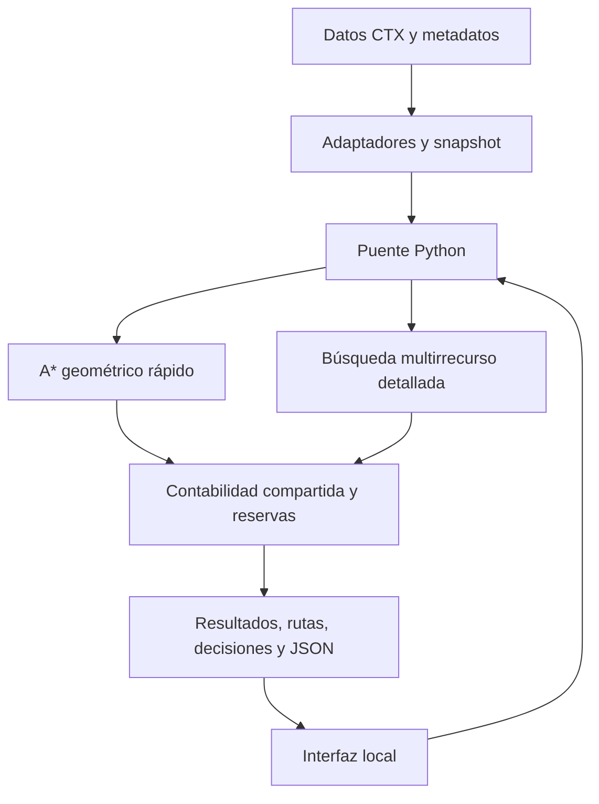

# Memoria técnica y de proyecto

## Resumen

MARS GOD'S EYE — Mission Planning Engine transforma elevaciones orbitales y perfiles configurables en misiones de ida, actividad científica y regreso. Ofrece planificación geométrica rápida, búsqueda detallada con restricciones de recursos y evaluación desde una posición intermedia. Una interfaz cartográfica local permite seleccionar puntos en Jezero y consultar consumos, reservas y explicaciones.

La contribución demostrable es conectar **datos topográficos trazables con decisiones de misión y contabilidad verificable**. No se atribuye la invención de A*, Dijkstra o búsqueda de etiquetas, ni se afirma novedad mundial sin una revisión del estado del arte.

## Problema y usuario

Una línea corta en un mapa no comprueba que haya recursos para realizar ciencia y volver. El usuario objetivo de este prototipo es un planificador/equipo educativo que explora escenarios de astronauta o rover; no es una autorización de operaciones de un astronauta real. Las restricciones deben verificarse separadamente: batería sobrante no compensa falta de otro recurso.

## Alcance implementado

- Inicio/base, un objetivo, actividad estacionaria y regreso.
- Posición intermedia y recursos restantes declarados manualmente.
- Snapshot de terreno, pendiente, huella, obstáculos y costos de terreno.
- Perfiles separados y reservas absolutas.
- Comparación acotada de políticas, continuación/regreso y escenarios de tasas.
- JSON versionado, identidad de datos y exportación de rutas.
- Interfaz localhost y mapa de Marte con área de cálculo de 2×2 km.

## Evolución

| Etapa | Aporte | Estado documentado |
|---|---|---|
| 1 | Snapshot, geometría y errores de interrupción | Cerrada |
| 2 | Perfiles, unidades, tasas y reservas | Cerrada experimental |
| 3 | Solicitud 3.0, fases y resultados explicables | Cerrada |
| 4 | Adaptador CTX y transformaciones Jezero | Cerrada, recorte pequeño |
| 5 | Contratos 5.0, alternativas y replanificación manual | Cerrada experimental |
| 6 | Cartografía, 2 km, candidato rápido y UI | Funcional; ampliación formalmente incompleta |
| Bootstrap | Migración privada, hashes y reproducción | Ver informe de migración |

No están terminados todo Jezero, color orbital verificado, curvas continuas y última revisión estrecha del flujo final. No hay ROS, sensores, movimiento físico ni integración definitiva Gods Eye View. Las siguientes mejoras 6.5–6.9 son roadmap, no resultados de este paquete documental.

## Arquitectura

CORE biblioteca estándar; NumPy para NPZ; Rasterio solo preparación offline; Leaflet local; teselas remotas para imágenes. El lector regional JSON no necesita Rasterio al calcular. El diseño futuro separa CORE, DATA ADAPTERS, MISSION API, ROS ADAPTER y EVALUATION.

## Valor e impacto: hipótesis, no medición de campo

Puede ayudar a explorar compromisos entre desplazamiento, actividad y reservas; visualizar fallos y reutilizar contratos. No se han medido mejoras de supervivencia, ahorro operacional real ni uso por astronautas. El número de tests demuestra regresión de software, no certificación científica.

## Demostración defendible

Mostrar una misión con resultado satisfactorio, después una perturbación o recurso insuficiente, y distinguir cálculo interrumpido. Comparar datos originales con hipótesis del perfil. El equipo debe atribuir por separado este módulo y los demás componentes del proyecto general.
